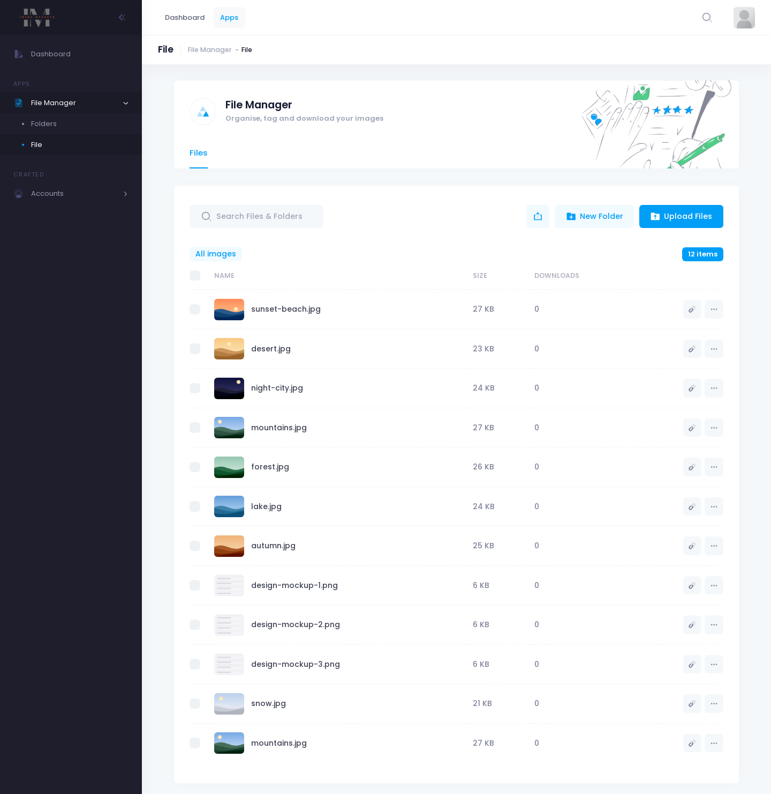

# Image Manager API

REST API for an image manager: users organise uploaded images into folders, tag them, move them, and download them. Built with Node.js, Express and MongoDB.

The Angular front end lives in [image-manager-frontend](https://github.com/belalyasin/image-manager-frontend).



## Features

- Sign up, log in, log out and change password (JWT, bcrypt)
- Sign in with Google (Passport, OAuth 2.0)
- Folders: create, nest, rename, move and delete
- Images: upload one or many (JPEG and PNG), edit, move between folders, download and delete
- Search images by tag
- User profile with avatar upload

## Tech stack

Node.js, Express 4, MongoDB, Mongoose 7, Multer, Sharp, Passport (Google OAuth 2.0), JSON Web Tokens

## Getting started

```bash
git clone https://github.com/belalyasin/image-manager-api.git
cd image-manager-api
npm install
cp config.env.example config.env   # then edit the values
npm run dev                        # nodemon, or: npm start
```

The app reads its settings from `config.env`:

| Name | Purpose |
| --- | --- |
| `PORT` | Port to listen on (default 3000) |
| `DB_URL` | MongoDB connection string |
| `JWT_KEY` | Secret used to sign tokens |
| `GOOGLE_CLIENT_ID`, `GOOGLE_CLIENT_SECRET` | Google OAuth credentials. Both are required for the server to start |

Uploaded files are stored in `uploads/` and served at `/uploads`.

## API

All routes are under `/api/v1`. Everything except sign-up, login and the Google routes needs an `Authorization: Bearer <token>` header.

**Users** (`/user`)

| Method | Route | Purpose |
| --- | --- | --- |
| POST | `/signup` | Create an account |
| POST | `/login` | Log in and get a token |
| POST | `/logout` | Log out |
| POST | `/changePassword` | Change password |
| GET | `/google` | Start Google sign-in |
| GET | `/` | Current user |
| GET, PUT, DELETE | `/:id` | Read, update (with `avatar` file) or delete a user |

**Folders** (`/folder`)

| Method | Route | Purpose |
| --- | --- | --- |
| GET, POST | `/` | List root folders, create a folder |
| GET, POST, PUT, DELETE | `/:id` | Read a folder, create a sub-folder, rename, delete |
| PUT | `/:id/move` | Move a folder |

**Images** (`/image`)

| Method | Route | Purpose |
| --- | --- | --- |
| GET, POST, DELETE | `/` | List images, upload (`images[]`), delete |
| GET, PUT, POST | `/:id` | Read an image, edit it, upload into folder `:id` |
| GET | `/folder/:id` | Images in a folder |
| PUT | `/:id/move` | Move an image to another folder |
| GET | `/:id/download` | Download an image |
| GET | `/tag` | Search by tag |
